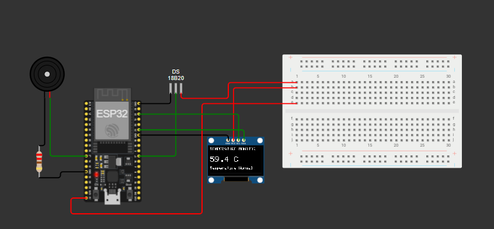

# 🌡️ IoT-Based Real-Time Temperature Monitoring and Alert System Using ESP32

## 📌 Project Overview

This project monitors temperature in real time using an ESP32 microcontroller and a DS18B20 temperature sensor. Temperature readings are displayed on an OLED screen and uploaded to the Adafruit IO cloud dashboard through Wi-Fi.

A buzzer provides an alert when the temperature exceeds the configured threshold of 60°C.

## ✨ Features

- 🌡️ Real-time temperature monitoring
- 📟 OLED temperature display
- 🚨 Buzzer alert for high temperatures
- ☁️ Cloud monitoring using Adafruit IO
- 📶 Wi-Fi connectivity
- 📊 Live temperature dashboard
- 🔧 ESP32-based embedded system

## 🧰 Hardware Components

- ESP32 development board
- DS18B20 temperature sensor
- SSD1306 OLED display (128 × 64)
- Buzzer
- 4.7 kΩ pull-up resistor for the DS18B20, if required
- Breadboard and jumper wires

## 🔌 Circuit Connections

| Component | ESP32 Pin |
|---|---|
| DS18B20 Data (DQ) | GPIO 17 |
| DS18B20 VCC | 3V3 |
| DS18B20 GND | GND |
| OLED SDA | GPIO 21 |
| OLED SCL | GPIO 22 |
| OLED VCC | 3V3 |
| OLED GND | GND |
| Buzzer signal | GPIO 27 |
| Buzzer GND | GND |

**Note:** Connect a 4.7 kΩ pull-up resistor between the DS18B20 data pin and 3V3 if required by your circuit.

## 💻 Software and Libraries

- Arduino IDE
- Wokwi ESP32 Simulator
- OneWire
- DallasTemperature
- Adafruit GFX Library
- Adafruit SSD1306
- Adafruit MQTT Library

## ☁️ Adafruit IO Configuration

1. Create an Adafruit IO account.
2. Create a temperature feed.
3. Create a dashboard with a gauge or graph.
4. Configure the feed key in the ESP32 program.
5. Connect the ESP32 to Wi-Fi.
6. Monitor live temperature readings on the dashboard.

**Security:** Never publish your actual Adafruit IO key or Wi-Fi password in a public repository.

## ⚙️ Working Principle

1. The DS18B20 measures the surrounding temperature.
2. The ESP32 reads the temperature data.
3. The OLED displays the current temperature.
4. When the temperature exceeds 60°C, the buzzer activates.
5. The ESP32 uploads temperature readings to Adafruit IO using MQTT.
6. The dashboard displays the received temperature values.

## 🚀 Future Improvements

- Temperature history graphs
- Mobile notifications for high temperatures
- Historical data logging
- Additional environmental sensors

- ## 🔗 Project Links

- **Wokwi Simulation:** [Run the ESP32 Temperature Monitoring Project](https://wokwi.com/projects/475883163867999233)
- **Adafruit IO Dashboard:** [View Temperature Dashboard](https://io.adafruit.com/tejaraj_sn13/dashboards/temperature)

## 📌 Project Status

- Temperature sensor: Working
- OLED display: Working
- High-temperature buzzer alert: Working
- Adafruit IO cloud monitoring: Working
- ## 🔌 Circuit Diagram

## 🔗 Project Links

- **Wokwi Simulation:** [Run the Project](https://wokwi.com/projects/475883163867999233)
- **Adafruit IO Dashboard:** [View Temperature Dashboard](https://io.adafruit.com/tejaraj_sn13/dashboards/temperature)

- ## 🔗 Project Links

- **Wokwi Simulation:** [Run the ESP32 Temperature Monitor](https://wokwi.com/projects/475883163867999233)
- **GitHub Repository:** [View Source Code](https://github.com/Tejarajsn/IoT-Based-Real-Time-Temperature-Monitoring-and-Alert-System-Using-ESP32)
- **Adafruit IO Dashboard:** [View Temperature Dashboard](https://io.adafruit.com/tejaraj_sn13/dashboards/temperature)

## 👨‍💻 Author

**Tejaraj S Nidagundi**  
Electronics and Communication Engineering (ECE)

## 🛠️ Technologies Used

- ESP32
- DS18B20 Temperature Sensor
- OLED Display (SSD1306)
- Buzzer Alarm
- Arduino C++
- Wi-Fi
- Adafruit IO
- Wokwi Simulator

## 👨‍💻 Author

**Tejaraj S Nidagundi**

Electronics and Communication Engineering

## 📄 Project Purpose

Developed as an educational IoT project to demonstrate sensor interfacing, embedded programming, OLED display control, buzzer alerts, Wi-Fi communication, and cloud-based monitoring.
